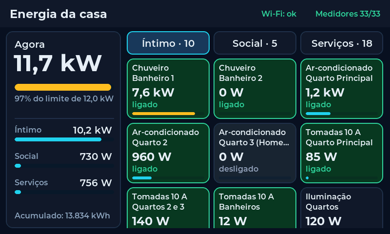
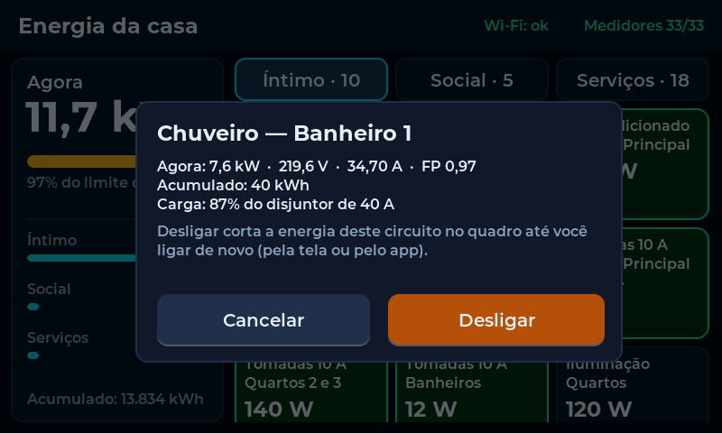
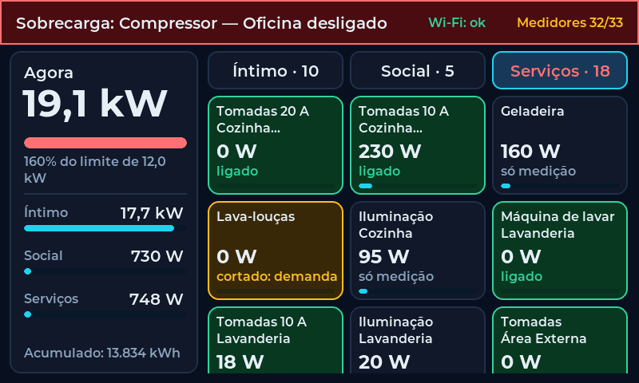
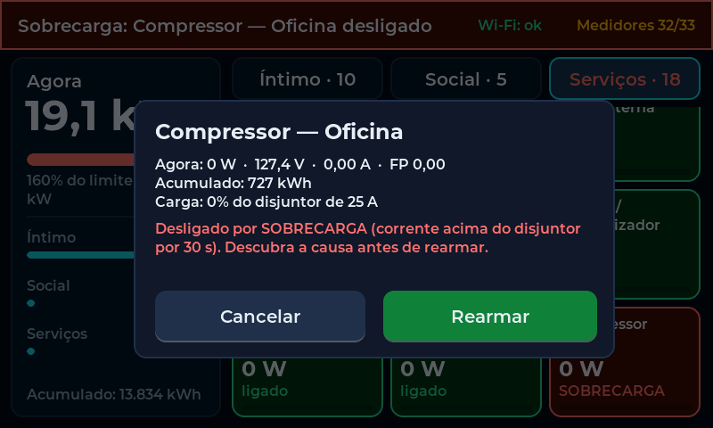

# Automação elétrica — ESP32-S3 Modbus RTU (PZEM-016 + relés Waveshare)

Análise do *Memorial Descritivo & Projeto de Automação — Sistema Industrial de Monitoramento Energético e
Controle Residencial via Modbus RTU e ESP32-S3* e a implementação no NexusHome OS (v2.11).

| Peça | Onde |
|---|---|
| Firmware do mestre Modbus (C++ / Arduino, ESP32-S3) | [`firmware/esp32s3_eletrica/esp32s3_eletrica.ino`](../firmware/esp32s3_eletrica/esp32s3_eletrica.ino) |
| Migração (comandos dos circuitos + automação por medidor) | [`supabase/migrations/023_eletrica.sql`](../supabase/migrations/023_eletrica.sql) |
| Dispositivos com UUID fixo (34) | [`supabase/seeds/eletrica.sql`](../supabase/seeds/eletrica.sql) |
| Envio em lote + alertas do firmware | [`supabase/functions/iot-gateway`](../supabase/functions/iot-gateway/index.ts) |
| App: total da casa, cartão do circuito, automação por medidor | `js/energy.js`, `js/panels/monitor.js`, `js/panels/devices.js`, `js/panels/automations.js` |

## 1. O que o memorial pede

- **Mestre**: ESP32-S3 HMI Touch 4.3" (SpotPear) com RS-485 nativo, interrogando todos os escravos em ciclo.
- **3 subquadros** em trilho DIN, ligados por um único barramento RS-485 em cascata (*daisy-chain*):

| Subquadro | Áreas | Relés | Medidores PZEM-016 |
|---|---|---|---|
| 1 — Íntimo | suítes, home office, banheiros, corredor | Waveshare 32 canais | 10 (ACs, chuveiros, tomadas 10 A, iluminação) |
| 2 — Social | salas de TV/estar, copa, corredor social | Waveshare 16 canais | 5 (tomadas 10 A, iluminação) |
| 3 — Serviços/Oficina | cozinha, área externa/serviço, oficina | Waveshare 32 canais + contatoras | 18 (cargas pesadas, 20 A, 10 A, luz) |

- **Medição**: 33 × Peacefair PZEM-016 com TC de 100 A → tensão, corrente, potência e kWh por circuito.
- **Atuação**: chuveiros de 7800 W e tomadas de 20 A da oficina via contatoras acionadas pelos relés.
- **Alimentação**: fonte 12 V / 150 W em trilho DIN.
- **Integração**: Home Assistant via MQTT.

## 2. Arquitetura no NexusHome

```
 Subquadro 1 ─┐   PZEM-016 ×33  (função 04, 9600 8N1)
 Subquadro 2 ─┼─ RS-485 ─ ESP32-S3 (mestre) ── Wi-Fi ── iot-gateway ── Supabase ── app (planta 3D)
 Subquadro 3 ─┘   relés ×3      (funções 01/05/0F)      POST em lote       │  realtime
                                                        GET /commands  ◄───┘  liga/desliga, automações
```

- O NexusHome faz o papel que o memorial dá ao Home Assistant: histórico, painel, automações e alertas no celular.
  O firmware não fala MQTT nesta versão (ver §10).
- A **proteção roda no ESP32**, não na nuvem: sobrecarga e gestão de demanda continuam funcionando sem internet
  (com o RS-485 direto, também sem Wi-Fi; pelo gateway, precisa da rede local — §8A).
- **Dois jeitos de ligar o ESP32 ao barramento** (`BUS_VIA_GATEWAY` no firmware):
  - **RS-485 direto** (padrão): a tela fica no quadro, com o par A/B saindo dela.
  - **Pelo gateway Waveshare RS485 TO WIFI/ETH** (§8A): o gateway fica no quadro e é o único mestre do RS-485; a
    tela pode ficar em qualquer cômodo, e o PC ou o Home Assistant também leem os medidores pela rede.
- A cada 15 s o ESP32 manda **um POST** com o estado dos 34 dispositivos (33 circuitos + total). O histórico
  (`telemetry_logs`) é gravado a cada 5 min por circuito — ou antes, numa mudança ≥ 100 W e ≥ 25% (no máx. 1 por
  minuto) — e a cada 1 min para o total.

## 3. ⚠️ Correções e lacunas do memorial (revise antes de comprar/montar)

1. **O PZEM-016 não usa os 12 V.** Ele é alimentado pela própria rede que mede (entrada de 80–260 V CA) e tira
   dali a alimentação isolada do RS-485. O passo 2 do memorial ("conecte a fonte 12 V a cada medidor PZEM") está
   errado: **cada PZEM precisa dos bornes de tensão ligados ao circuito que mede**, e a fonte de 12 V alimenta só
   as placas de relé (e o ESP32, se for o caso).
2. **Tensão certa em cada PZEM.** Na rede 127/220 V, o chuveiro de 7800 W é carga **fase-fase (220 V)**: os bornes
   de tensão desse PZEM vão em F-F, e o TC abraça **uma** das fases. Ligado em F-N (127 V), a potência medida sai
   com ~58% do valor real. Tomadas e luz de 127 V: F-N. O TC sempre num condutor só — nunca fase e neutro juntos
   (o memorial acerta nisso).
3. **Contatoras dos chuveiros.** 7800 W / 220 V = **35,5 A**: a faixa "25 a 50 A" do memorial inclui valores
   que não servem. Use contator modular de **40 A AC-1** (2 polos, para cortar as duas fases), cabo de 6 mm²,
   disjuntor de 40 A e **DR de 30 mA** — obrigatório em banheiros pela NBR 5410. "Contator auxiliar" é peça de
   comando; para a carga, contator **de potência**. Tomadas de 20 A da oficina: contator de 25 A.
4. **Nenhum circuito de tomadas direto no relé.** Os relés das placas Waveshare são de ~10 A (confira a etiqueta);
   circuito de tomadas com disjuntor de 16–20 A passa por **contator**, mesmo os "10 A". Direto no relé, só
   iluminação. Coloque **supressor RC** (snubber) na bobina de cada contator.
5. **Falha segura.** O memorial não diz o que acontece quando o ESP32, a fonte ou o barramento falham. O firmware
   assume **relé energizado = carga cortada**: a bobina do contator é alimentada pelo contato **NC** do relé, então
   com o sistema desligado a casa continua com energia (`RELAY_ENERGIZED_CUTS true`). Se ligar no NO, inverta a
   constante — mas aí qualquer falha apaga a casa.
6. **Luz sem comando manual.** Se as luzes forem só pelos relés, uma pane (Wi-Fi, ESP32, fonte) deixa a casa sem
   como acender a luz. Mantenha os interruptores: o relé Waveshare tem COM/NO/NC e funciona como **three-way**
   (paralelo) com o interruptor da parede — qualquer um dos dois liga/desliga. Outra opção: pulsadores lidos por
   um módulo de entradas Modbus. **Decisão do projeto (out/2026): interruptores mantidos, em paralelo
   (three-way) com os relés.** Com o ESP32 parado, o relé fica em repouso e o interruptor continua mandando.
   Os circuitos de iluminação seguem na tabela como **só medição**; os pontos de luz em three-way usarão os
   canais livres (§5) e um comando de **alternar** (num three-way o relé não sabe se a luz está acesa — quem diz
   é a corrente medida), ainda não implementado (§10).
7. **Barramento RS-485 grande demais para um ramo só.** São 36 escravos + o mestre = 37 nós; o padrão RS-485
   garante 32 cargas unitárias por segmento, e os transceptores do PZEM não têm a carga publicada. Além disso, os
   3 quadros ficam em pontos diferentes da casa. Recomendação: um **hub/repetidor RS-485 isolado** no quadro do
   mestre, com **um ramo por subquadro** (isola surtos e diferenças de terra entre quadros e divide a carga);
   cada ramo com 120 Ω nas **duas** pontas (o ESP32-S3 tem o jumper "120R" ao lado do conector), par trançado
   blindado com A, B **e o GND de referência**, blindagem aterrada num ponto só, e longe dos cabos de 220 V (ou
   com isolação para a maior tensão, NBR 5410).
8. **O PZEM-016 só fala 9600 baud** → uma volta pelos 33 medidores leva ~2,5–3,5 s. Por isso o elétrico deve ficar
   **numa placa e num barramento separados da hidráulica**, cuja segurança lê tudo a cada 1 s. Os endereços foram
   escolhidos sem conflito (1–4 são da hidráulica) caso um dia queira juntar.
9. **Fonte de 12 V.** 150 W sobra muito (uma placa de 32 relés com tudo energizado consome algo da ordem de
   15–20 W — confira a tabela de consumo da Waveshare), mas
   levar 12 V de um quadro aos outros dá queda de tensão e junta as falhas. Melhor uma fonte pequena por
   subquadro (as placas Waveshare aceitam 7–36 V).
10. **Ar-condicionado inverter** não deve ter a alimentação cortada no dia a dia com o compressor rodando: o
    firmware só corta os ACs por **sobrecarga** ou **gestão de demanda** (prioridade 2). Para ligar/desligar,
    use o controle do aparelho (a integração SmartThings já faz isso).
11. **Software não é proteção.** O corte por sobrecarga atua *antes* do disjuntor para evitar ficar sem o
    circuito, mas disjuntores, DR e DPS continuam obrigatórios e dimensionados por projeto elétrico (com ART).
12. **TC de 100 A em circuito de iluminação** (0,2–2 A) mede com pouca resolução. Para luz e tomadas, o
    **PZEM-016 de 10 A** (shunt interno, sem TC) é mais preciso e mais barato; deixe o de 100 A para chuveiros,
    ACs e cargas pesadas.
13. **Falta o quadro de cargas.** O memorial não lista os circuitos (nome, disjuntor, cômodo, canal). A tabela do
    §5 é **provisória** e segue só a contagem de medidores por subquadro. Também cita cômodos que não existem na
    planta importada (suítes, home office, copa, corredor, oficina): o seed usa os cômodos da planta onde dá.

## 4. Endereços (Slave ID) — 9600 8N1 em todos

| Endereço | Equipamento |
|---|---|
| 1–4 | reservados à automação hidráulica (contadoras, sonda, relés das válvulas) |
| 5 | relés Waveshare 32 ch — Subquadro 1 (Íntimo) — exemplo do próprio memorial |
| 6 | relés Waveshare 16 ch — Subquadro 2 (Social) |
| 7–16 | PZEM-016 do Subquadro 1 — exemplo do próprio memorial |
| 17–21 | PZEM-016 do Subquadro 2 |
| 22 | relés Waveshare 32 ch — Subquadro 3 (Serviços/Oficina) |
| 23–40 | PZEM-016 do Subquadro 3 |

Todos saem de fábrica com endereço **1**. Grave um por vez, **com só aquele aparelho no barramento**, pelo
monitor serial do próprio firmware (não precisa do software do fabricante):

- `pzemaddr 7` — grava 7 no PZEM ligado (usa o endereço geral 0xF8, registrador 0x0002);
- `reladdr 5` — grava 5 na placa de relés que ainda está com o endereço 1 (registrador 0x4000);
- `scan` — lista quem responde de 1 a 60.

## 5. Circuitos (provisório — ajuste ao quadro de cargas)

Prioridade de corte por demanda: 1 = corta primeiro · 2 = depois · 3 = por último · — = nunca.

| # | Circuito | PZEM | Relé (placa/canal) | Disjuntor | Corte |
|---|---|---|---|---|---|
| 1 | Chuveiro — Banheiro 1 | 7 | 5 / 1 → contator 40 A | 40 A | 3 |
| 2 | Chuveiro — Banheiro 2 | 8 | 5 / 2 → contator 40 A | 40 A | 3 |
| 3 | Ar-condicionado — Quarto Principal | 9 | 5 / 3 → contator | 16 A | 2 |
| 4 | Ar-condicionado — Quarto 2 | 10 | 5 / 4 → contator | 16 A | 2 |
| 5 | Ar-condicionado — Quarto 3 (Home Office) | 11 | 5 / 5 → contator | 16 A | 2 |
| 6 | Tomadas 10 A — Quarto Principal | 12 | 5 / 6 → contator | 16 A | — |
| 7 | Tomadas 10 A — Quartos 2 e 3 | 13 | 5 / 7 → contator | 16 A | — |
| 8 | Tomadas 10 A — Banheiros | 14 | 5 / 8 → contator | 16 A | — |
| 9 | Iluminação — Quartos | 15 | — | 10 A | — |
| 10 | Iluminação — Banheiros e Corredor | 16 | — | 10 A | — |
| 11 | Tomadas 10 A — Sala de Estar | 17 | 6 / 1 → contator | 16 A | — |
| 12 | Tomadas 10 A — Sala de TV | 18 | 6 / 2 → contator | 16 A | — |
| 13 | Tomadas 10 A — Copa | 19 | 6 / 3 → contator | 16 A | — |
| 14 | Iluminação — Salas | 20 | — | 10 A | — |
| 15 | Iluminação — Copa e Corredor Social | 21 | — | 10 A | — |
| 16 | Tomadas 20 A — Cozinha (forno/micro-ondas) | 23 | 22 / 1 → contator 25 A | 25 A | 1 |
| 17 | Tomadas 10 A — Cozinha (bancada) | 24 | 22 / 2 → contator | 16 A | — |
| 18 | Geladeira | 25 | — (nunca cortar) | 16 A | — |
| 19 | Lava-louças | 26 | 22 / 3 → contator | 16 A | 1 |
| 20 | Iluminação — Cozinha | 27 | — | 10 A | — |
| 21 | Máquina de lavar — Lavanderia | 28 | 22 / 4 → contator | 16 A | 1 |
| 22 | Tomadas 10 A — Lavanderia | 29 | 22 / 5 → contator | 16 A | — |
| 23 | Iluminação — Lavanderia | 30 | — | 10 A | — |
| 24 | Tomadas — Área Externa | 31 | 22 / 6 → contator | 16 A | — |
| 25 | Iluminação — Área Externa | 32 | 22 / 7 (direto) | 10 A | — |
| 26 | Portão eletrônico | 33 | — | 10 A | — |
| 27 | Bomba / pressurizador | 34 | 22 / 8 → contator | 16 A | 1 |
| 28 | Tomadas 20 A — Oficina (bancada 1) | 35 | 22 / 9 → contator 25 A | 25 A | 1 |
| 29 | Tomadas 20 A — Oficina (bancada 2) | 36 | 22 / 10 → contator 25 A | 25 A | 1 |
| 30 | Compressor — Oficina | 37 | 22 / 11 → contator 25 A | 25 A | 1 |
| 31 | Tomadas 10 A — Oficina | 38 | 22 / 12 → contator | 16 A | — |
| 32 | Iluminação — Oficina | 39 | 22 / 13 (direto) | 10 A | — |
| 33 | Circuito reserva — Subquadro 3 | 40 | — | 16 A | — |

Os canais livres (5 / 9–32, 6 / 4–16, 22 / 14–32) ficam para os pontos de luz em three-way (§3.6). Para mudar
um circuito: edite a tabela `CIRCUITS` no firmware **e** o nome/cômodo no app (menu ⋯) — os UUIDs não mudam.

## 6. Proteção no firmware

| Função | Regra | Ação |
|---|---|---|
| Sobrecarga | corrente ≥ 95% do disjuntor por 30 s | circuito com relé: **corta e trava** + alerta crítico (push). Sem relé: alerta de atenção |
| Religar após sobrecarga | pelo app: só depois de 5 min · pela serial: `rearmar N` a qualquer momento | — |
| Gestão de demanda | soma > `DEMAND_LIMIT_W` por 10 s | corta o circuito ligado de menor prioridade (o de maior consumo entre os de mesma prioridade), um a cada 10 s, + alerta |
| Volta da demanda | o último cortado cabe com folga de 1 kW por 2 min | religa, um por vez |

- `DEMAND_LIMIT_W` vem **desligado (0)**: configure com o limite da sua entrada (ex.: bifásico 220 V com
  disjuntor geral de 63 A ≈ 13,8 kW → use ~12000). Com ele ligado, o card Energia do app passa a avisar em 85%
  e 100% desse limite; desligado, o app não gera alerta de consumo (cada chuveiro passa de 4,5 kW).
- Liga/desliga e desarmes ficam gravados na flash: um reinício não religa o que o usuário desligou.
- A placa de relés que reiniciar volta com tudo desenergizado (= tudo ligado): o firmware reenvia o estado a cada 30 s.

## 7. Instalação e operação (ordem revisada)

1. **Projeto elétrico**: quadro de cargas, disjuntores, DRs e DPS (com ART). Preencha o §5 com os circuitos reais.
2. **Trilhos DIN**: placa de relés, PZEMs e contatores em cada subquadro; hub RS-485 isolado e o ESP32-S3 no quadro do mestre.
3. **Força dos PZEM**: bornes de tensão de cada PZEM no circuito que ele mede (F-N ou F-F, §3.2).
4. **Comando**: fonte 12 V (uma por subquadro) nas placas de relé; bobinas dos contatores pelo contato **NC** dos relés, com RC.
5. **TCs**: um condutor de fase por TC, seta no sentido da carga.
6. **Endereços**: um aparelho por vez no barramento, `pzemaddr` / `reladdr` (§4).
7. **RS-485**: ramos em cascata a partir do hub, 120 Ω nas pontas; `scan` deve listar 5, 6, 7–21, 22, 23–40.
8. **NexusHome** (feito pelo dono do projeto):
   - SQL Editor: `supabase/migrations/023_eletrica.sql` e depois `supabase/seeds/eletrica.sql`;
   - `supabase functions deploy iot-gateway` (envio em lote e alertas do firmware).
9. **Firmware**: `powershell -ExecutionPolicy Bypass -File scripts\instalar-arduino.ps1 -Firmware eletrica -Porta COM6`
   — copia para `Documentos\Arduino\esp32s3_eletrica`, onde você preenche Wi-Fi e `DEVICE_SECRET`.
   Compilado aqui com o core `esp32:esp32` 3.3.12 + ESP32_Display_Panel 1.0.4 + lvgl 8.4.0 para a 4.3B, com a tela:
   1,60 MB (50% da partição de 3 MB), 19% da RAM. Sem tela: `USE_DISPLAY 0` (1,03 MB).
10. **Bancada (serial 115200)**: `status` mostra cada circuito (W, A, V, kWh, ligado/cortado); `desligar N` / `ligar N`
    devem estalar o relé e o contator; com uma carga conhecida (ex.: chuveiro), confira a potência.

## 8. Tela touch do quadro elétrico (ESP32-S3-Touch-LCD-4.3B, 800×480)

Uma tela para a hidráulica e **outra para a elétrica** (placas e barramentos separados, §3.8). Arquivos: `ui.cpp` /
`ui.h` (interface), `lvgl_v8_port.*`, `lv_conf.h`, `esp_panel_*_conf.h` (placa 4.3B já selecionada) e as fontes
`nh_font_*.c` — as mesmas da tela da água, com a de 48 px acrescida das letras de "kW". `USE_DISPLAY 1` no `.ino`.

| Situação normal | Toque num circuito | Sobrecarga | Rearmar |
|---|---|---|---|
|  |  |  |  |

- **À esquerda, a casa inteira**: consumo agora (em W/kW), barra em relação ao limite de demanda (amarela a partir
  de 85%, vermelha no limite), consumo por subquadro e o acumulado em kWh.
- **À direita, uma aba por subquadro** (Íntimo · Social · Serviços) com um quadro por circuito: potência, estado e
  uma barrinha de carga no disjuntor. Verde = ligado, cinza = desligado, vermelho = **sobrecarga** (travado),
  âmbar = **cortado pela demanda**, "só medição" = sem relé. A lista rola com o dedo.
- **Tocar num circuito** mostra tensão, corrente, fator de potência, kWh e a carga no disjuntor, com o botão de
  **Desligar** / **Ligar** — nada muda sem esse segundo toque. Desarmado por sobrecarga: o botão vira **Rearmar**
  (pela tela, sem a espera de 5 min do app — quem está no quadro vê a causa).
- **Faixa do topo**: vermelha com sobrecarga, âmbar com corte de demanda; **tocar nela abre o circuito** (mesmo que
  esteja em outra aba ou mais abaixo na lista). A aba que esconde o problema também muda de cor.
- A tela só envia pedidos para a mesma fila do app e da serial; quem fala com o barramento é o loop principal.
- Imagens geradas renderizando o `ui.cpp` real com LVGL 8.4 num simulador (sem a placa), com dados de exemplo.
- Créditos: `lvgl_v8_port.*` e os `esp_panel_*_conf.h` vêm dos exemplos do ESP32_Display_Panel (Espressif,
  Apache-2.0); as fontes `nh_font_*.c` foram geradas com lv_font_conv a partir da Montserrat (SIL OFL 1.1).

## 8A. Gateway RS485 TO WIFI/ETH (Waveshare) no quadro elétrico

O mesmo conversor da automação hidráulica. Aqui ele vira a **ponte entre a rede e o barramento**:

```
 Subquadros (relés + 33 PZEM) ── RS-485 ── Gateway RS485 TO WIFI/ETH ── cabo de rede ── roteador
                                            (único mestre Modbus RTU)                    │ Wi-Fi
                                                                                         ├── ESP32-S3 + tela (qualquer cômodo)
                                                                                         └── PC / Home Assistant (leitura)
```

**Por que vale a pena:** com o gateway em modo de conversão **Modbus TCP ⇄ RTU**, todos os pedidos passam por ele e
ele os faz um de cada vez no RS-485. Assim o ESP32, o Modbus Poll do PC e o Home Assistant podem consultar o
quadro **ao mesmo tempo sem colisão**. A colisão era o motivo de, na hidráulica, o gateway ficar só para
diagnóstico. A tela também deixa de precisar morar dentro do quadro.

**Cuidados:**
- **A rede passa a fazer parte da proteção.** Sem Wi-Fi entre a tela e o gateway, o ESP32 não lê os medidores:
  corte por sobrecarga e gestão de demanda param. Os relés mantêm o último estado e, com a fiação no NC (§3.5), a
  casa continua com energia. Depois de 1 min sem gateway, o app recebe o alerta "Gateway RS-485 sem conexão".
  Disjuntores e DR continuam sendo a proteção de verdade (§3.11).
- **Um mestre só no RS-485.** Ou o ESP32 fala pelo gateway (`BUS_VIA_GATEWAY 1`), ou pelo RS-485 direto com o
  gateway **ligado ao barramento sem consultar ninguém**. Nunca os dois perguntando no mesmo par A/B.
- Desligue no gateway qualquer **leitura automática** própria ("Modbus polling", MQTT com consulta periódica): isso
  também seria um segundo mestre.
- O PC e o Home Assistant devem **só ler**. Ligar e desligar relés por fora pula a lógica do ESP32 (sobrecarga,
  demanda, estado salvo): use o app, a tela ou as automações do NexusHome.

**Configuração do gateway** (página web do aparelho, pelo Wi-Fi dele ou pela rede; a ferramenta de busca da
Waveshare acha o IP. Os IPs de fábrica citados na wiki são 10.10.100.254 / 10.10.110.254):
1. **Alimentação**: 5–36 V DC da fonte de 12 V do quadro.
2. **RS-485**: A→A e B→B no início do barramento (ou no hub isolado, §3.7), com **120 Ω** nessa ponta.
3. **Serial**: **9600 bps, 8N1**. É obrigatório, porque o PZEM-016 só fala 9600.
4. **Rede**: de preferência **cabo** até o roteador, com **IP fixo** (ex.: `192.168.1.200`) reservado no roteador.
5. **Modo**: servidor TCP na porta **502** com **conversão Modbus TCP ⇄ RTU**. Se o seu lote só tiver o modo
   transparente, use `GATEWAY_MBAP false` no firmware.
6. **Firmware** (`esp32s3_eletrica.ino`): `BUS_VIA_GATEWAY 1`, `GATEWAY_IP "192.168.1.200"` e `GATEWAY_PORT 502`.
   O comando `status` na serial mostra "gateway … conectado".
7. **Teste com o PC** (antes do ESP32): no Modbus Poll / QModMaster, conexão TCP no IP do gateway, porta 502,
   *slave* 7, função 04, endereço 0, 10 registradores. Deve aparecer a tensão do primeiro PZEM (ex.: 2200 = 220,0 V).
8. **Home Assistant** (opcional): integração Modbus `type: tcp`, `host: 192.168.1.200`, `port: 502`, sensores de
   *input registers* com `slave` = endereço de cada PZEM (§4) e os mesmos registradores do item 7.

Compilado com o core `esp32:esp32` 3.3.12 nos três modos (RS-485 direto, gateway Modbus TCP e gateway
transparente): ~1,6 MB (50% da partição), 19% da RAM, sem avisos. Ainda não testado com o gateway de verdade.

## 9. No app NexusHome

- Cada circuito aparece no cômodo dele como **medidor**: potência em destaque, **V · A · kWh · FP**, barra de
  carga em relação ao disjuntor e selos *desligado por sobrecarga*, *cortado pela demanda* ou *medidor sem
  resposta*. Circuitos com relé ganham o **liga/desliga** — o banco transforma em comando para o ESP32
  (migração 023), que o busca em até 5 s.
- O card **Energia** soma a última leitura de cada medidor; com o "Quadro elétrico — consumo total" reportando,
  os circuitos não entram de novo na conta.
- **Automações por medidor**: no gatilho, "Leitura de" escolhe um medidor (o total do quadro aparece primeiro).
  Ex.: *se Chuveiro — Banheiro 1 > 7000 W → desligar Lava-louças*. Sem a 023, o servidor ignora o filtro — o app
  avisa ao salvar. Circuitos com relé também podem ser **alvo** de automações (ligar/desligar).
- Alertas do firmware (sobrecarga, demanda) entram na lista de alertas; os críticos vão por push/Telegram.

### Volume de dados

~10–15 mil linhas por dia em `telemetry_logs` para o elétrico (a hidráulica grava ~50 mil). No plano gratuito do
Supabase (500 MB), vale apagar o histórico antigo de vez em quando — por exemplo, no SQL Editor:

```sql
delete from public.telemetry_logs where created_at < now() - interval '90 days';
```

## 10. Ainda não implementado

- **Home Assistant / MQTT**: dá para publicar com *MQTT discovery* a partir do mesmo firmware, se ainda quiser o HA
  junto com o NexusHome.
- **Consumo por dia/mês e custo (tarifa)**: os kWh acumulados de cada PZEM já chegam; falta o relatório.
- **Pontos de luz em three-way** (interruptores mantidos em paralelo, §3.6): falta o comando de *alternar* pelos
  canais livres e saber se cada luz está acesa pela corrente do circuito.
